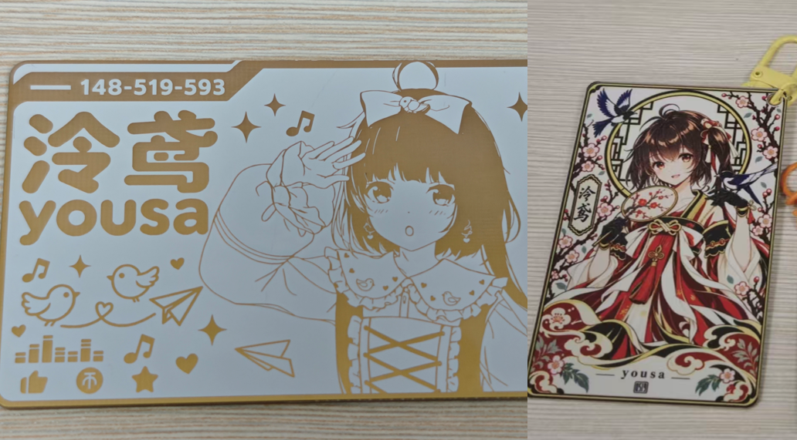

# 泠鸢 yousa NFC PCB · 羁绊环游线

泠鸢 yousa 主题 NFC 纪念卡片，记录「羁绊环游线」的相聚。提供嘉立创 EDA 专业版工程、设计素材和成品展示，焊接匹配的 NFC 芯片后可使用 NFC 功能。

**重点推荐：PCB1沉金、PCB2丝印（彩色丝印）。两款均按板厚 1.2 mm、白色阻焊下单。**

[展示视频(p1)和下单流程演示(p2)：哔哩哔哩 BV15iJ86fE7V](https://www.bilibili.com/video/BV15iJ86fE7V/) · [嘉立创下单教程](docs/ORDERING.md) · [四块板与工程说明](docs/HARDWARE.md) · [NFC 焊接与使用](docs/NFC.md)



## 两种重点效果

| | PCB1沉金 | PCB2丝印（彩色丝印） |
| --- | --- | --- |
| 外观 | 白色底板与金属金色人物、文字和装饰 | 全彩人物插画与卡牌边框 |
| 对应素材 | [可编辑 PPT](artwork/pcb1/冷鸢yousa_PCB.pptx) | [彩色原图](artwork/pcb2/yousa图片1.png) |
| 图案实现 | 铜层图形与阻焊开窗，沉金形成金色效果 | 顶层彩色丝印图片，配合工程内铜层和阻焊层 |
| 板厚 / 阻焊 | **1.2 mm / 白色** | **1.2 mm / 白色** |
| 焊盘喷镀 / 表面处理 | **沉金** | **沉金**，按嘉立创彩色丝印工艺要求 |
| 字符工艺 | 保留工程普通字符设置，无需为金色图案启用彩色丝印 | **嘉立创 EDA 彩色丝印** |

彩色丝印和沉金是不同的工艺项目，可以同时使用。PCB2 只选「沉金」不会自动得到全彩人物；还必须开启彩色丝印并提交对应的彩色制造数据。下单步骤及官方依据见[详细教程](docs/ORDERING.md)。

## 工程下载与四块 PCB

[下载完整原始工程](hardware/ProPrj_泠鸢yousa-NFC电路板-羁绊环游线_2026-10-26.epro2)，导入嘉立创 EDA **专业版**。原始文件本身是一个工程包，内部包含以下四个 PCB 文档：

| 工程内名称 | 定位 | 单板拆分包 |
| --- | --- | --- |
| **PCB1沉金** | 重点：金色图案版本 | [PCB1沉金.epro2](hardware/single-board/PCB1沉金.epro2) |
| **PCB2丝印** | 重点：全彩插画版本 | [PCB2丝印.epro2](hardware/single-board/PCB2丝印.epro2) |
| PCB1丝印 | 丝印图案备选版本，名称不代表沉金图案 | [PCB1丝印.epro2](hardware/single-board/PCB1丝印.epro2) |
| PCB2沉金 | 沉金图案备选版本 | [PCB2沉金.epro2](hardware/single-board/PCB2沉金.epro2) |

**优先使用完整原始工程。** 单板包保留了对应 PCB 的原始记录、共享器件库与图片资源，已检查 ZIP 结构及 PCB 记录一致性，尚未在 EDA 中完成导入验证。若单板包导入异常，请改用完整工程并打开对应 PCB 文档。当前未提供 Gerber 生产包，需在 EDA 中自行导出，PCB2 须勾选彩色丝印。

## 成品、设计展示与 NFC 芯片


工程原说明标注芯片为 **COB-CUID**。照片仅作为选型外观参考，具体封装尺寸、协议及存储能力需要核对购买型号。PCB 下单默认得到裸板，NFC 芯片需另购并焊接。

## 文件目录

```text
yousa-NFC-PCB/
├── hardware/               完整原始工程、四个单板拆分包、板卡清单
├── artwork/pcb1/           PCB1 的可编辑 PPT
├── artwork/pcb2/           用户原图及工程内实际嵌入的插画副本
├── preview/                成品展示、芯片照片、四块板的编辑器缩略图
├── docs/ORDERING.md        嘉立创下单步骤与两款工艺对照
├── docs/HARDWARE.md        四块板的核对记录和文件说明
├── docs/NFC.md             焊接、读取和写入说明
└── SHA256SUMS.txt          发布文件校验值
```

## 已知问题

- 原工程说明提示：PCB2 边缘可能出现微小留白，建议在下单前调整图片与板框的覆盖关系，并核对生产稿。
- 工程内四块板的板框尺寸略有差异，请以各自导出的板框和下单解析结果为准，勿统一填成同一尺寸。
- 原工程保存的层叠厚度不等于本项目的下单要求。下单时请手动选择 **1.2 mm**，勿沿用默认的 1.6 mm。
- 本次整理保留源工程设计，未进行实板电气、射频或生产验证。NFC 读写结果以具体芯片、焊接与设备测试为准。

## 参考与致谢

- 项目整理与发布：[hysdanny](https://github.com/hysdanny)。
- README 的展示组织参考 [alsunmengy/GPT-PCB-Art](https://github.com/alsunmengy/GPT-PCB-Art)，本项目的工程、尺寸及工艺参数以本仓库为准。
- 原工程列出的设计参考：[NFC 参考项目一](https://oshwhub.com/azheng01/highly-restore-nfc-presidents-me)、[NFC 参考项目二](https://oshwhub.com/tlaus/ai-li-nfc-chi-zi)。
- 设计与制作平台：嘉立创 EDA 专业版、嘉立创 PCB。

本仓库用于同好交流和项目复现。角色形象、插画、标识等素材的权利归各自权利人所有；本仓库未额外声明统一的开源许可证，参考仓库的许可证不自动适用于本项目。
