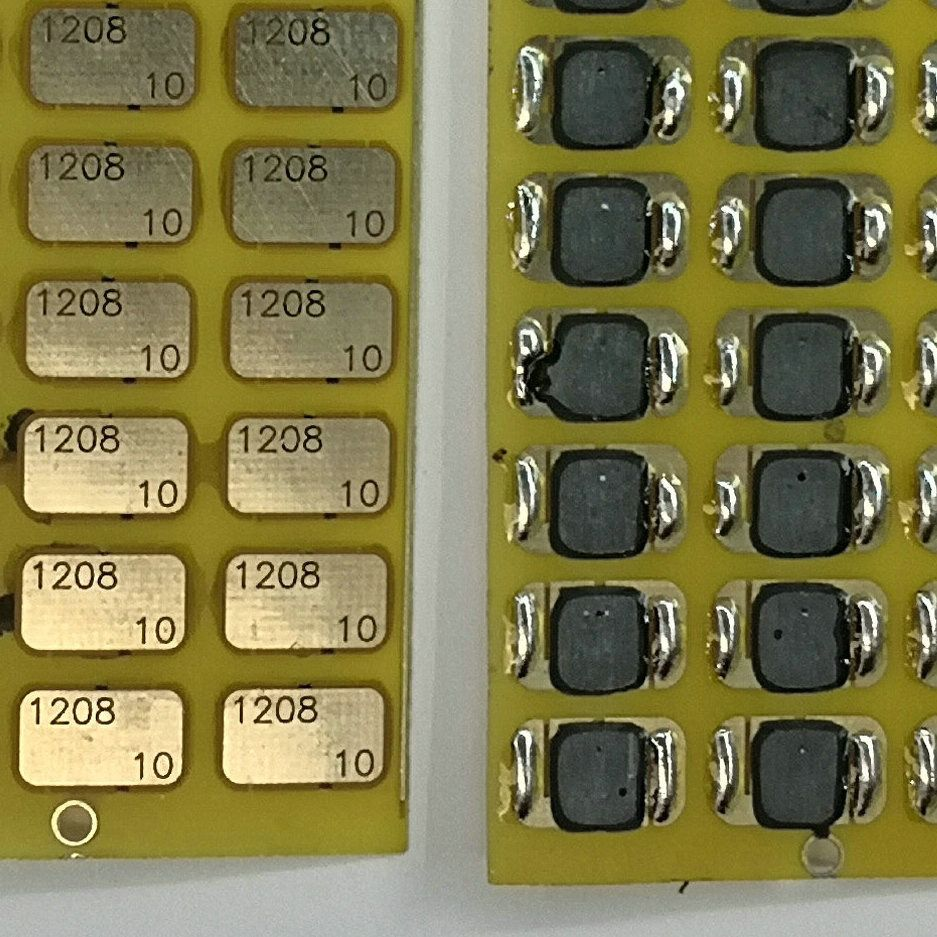

# NFC 芯片、焊接与使用

工程介绍说明需要焊接一片 NFC 芯片，原工程标注为 **COB-CUID**。以下照片是用户提供的参考外观，不足以单独确认具体型号和电气参数。



## 准备与焊接

1. 根据工程内的焊盘、芯片尺寸及供应商规格选择匹配的 NFC 芯片，核对封装与触点。不要直接套用其他项目的芯片尺寸。
2. 打样订单通常只包含裸 PCB。芯片、挂绳等配件需自行准备。
3. 按芯片资料焊接到对应两端焊盘，检查虚焊、短路和线圈损伤。
4. 手机开启 NFC，将卡片靠近手机的 NFC 天线区，先确认能稳定识别，再尝试写入。

## 读取与写入

可使用正规渠道获取的 NFC 读写工具查看芯片类型、协议、容量及是否支持 NDEF。**CUID 名称本身不保证芯片已格式化为 NDEF，也不保证手机工具可以直接写网页记录。**

如果选用的芯片及应用支持 NDEF，可以在写入页面添加 URI/网址记录，将本项目的视频链接写入：

```text
https://www.bilibili.com/video/BV15iJ86fE7V/
```

写入后再次读取，确认记录正确，并在目标手机上实际测试。应用启动记录和自动跳转行为还取决于手机系统、应用支持及用户设置，不保证所有手机行为一致。

如果无法识别，先检查手机 NFC 是否开启、感应位置、芯片兼容性、焊接和线圈完整性。如果能识别但不能写入，进一步检查写保护、存储容量和 NDEF 格式支持。本文未对具体芯片完成读写实测。
